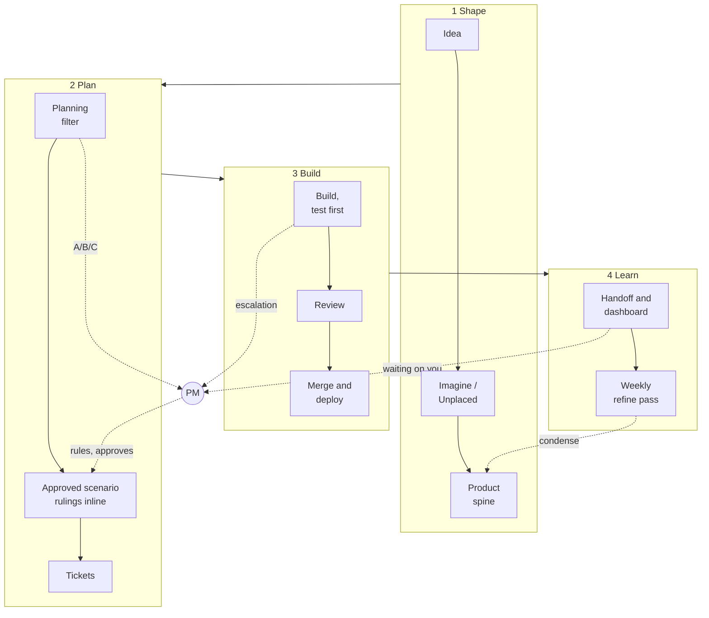

# socialus-ops

**As of 2026-10-12** · Source: the live repos, the planning dashboard, workflows and scheduled tasks read today · Generated by: `regen-readme`

**How SocialUs gets built: the method agents follow, from an idea to a shipped feature.** No product code lives here.

## How we build, step by step

**Every feature walks the same path, and the PM steps in only where judgement is needed.** Agents prove a change is correct; the PM decides whether it is right. *Why agents need it:* pass/fail criteria mean they build exactly what was approved; test-first means nothing silently breaks.

1. **Idea**: anyone raises it. Nothing is promised yet.
2. **Imagine / Unplaced**: shapeless ideas wait in `IMAGINE`; anything else homeless waits in the junk drawer, emptied within 14 days.
3. **Product spine**: once an idea has a noun, a verb or a screen, it becomes an entry in the product model.
4. **Planning filter**: a council of agents writes a short brief with options. **The PM approves or picks A/B/C.**
5. **Approved scenario**: the pass/fail criteria, with the PM's rulings written right inside it.
6. **Tickets**: one Issue per piece of work.
7. **Build, test first**: a check is seen failing before the code is written.
8. **Review**: a second agent reviews. Screens get a look at phone width.
9. **Merge and deploy**: green checks merge. **The code repo's main deploys to production.**
10. **Handoff and dashboard**: at 5am and 5pm the dashboard shows where we are and where we're going, and the handoff saves state so a restart picks up where we left off. **The PM looks and ticks.**
11. **Weekly refine pass**: on Fridays, any doc near its size limit is rewritten shorter and clearer.

Details

| Step | Who | Reads → writes | The PM |
|---|---|---|---|
| 2 | any agent | → `IMAGINE.md`, `UNPLACED.md` | none |
| 3 | planning agent | → product spine (`product/`) | none |
| 4 | `plan-feature` (council) | spine, principles → feature brief | approves, or picks A/B/C |
| 5 | planning agent | brief → scenario, with its rulings under "Rulings" | rules on new territory |
| 6 | `write-tickets` | scenario → Issues | none |
| 7 | `build-ticket` | Issue, constraints → code and tests | escalations only |
| 8 | reviewer agent, `review-pr-bundle` | the PR → review | when a review needs a call |
| 9 | code agent | → main | new copy, anything reaching production |
| 10 | Dispatch | GitHub → dashboard, handoff state | ticks the checklist |
| 11 | `tend-docs` (Fridays) | docs near budget → shorter docs | at most 3 calls a week |

## Who does what

**The PM rules; agents build and prove.** Each agent sees only the files its role needs. *Why agents need it:* a narrow view keeps them from acting on another role's half-finished work.

Details

- **PM:** rulings, whether something is right, the look. Never reads code.
- **Planning agent (Cowork):** scenarios, principles, the product model. Never commits code.
- **Code agent:** Issues, test-first code, PRs, merge on green. Never writes scenarios or rulings.
- **Dispatch:** phone intake, the 5am/5pm handoff, the dashboard.
- **Repos:** plan (what and why), web (the app), ops (this method), skills (32), legal (private), design (local).

## Where things live

**Each kind of thing has one home, and docs hold what is true now plus why, never history.** Git keeps the history. *Why agents need it:* one home per fact, so nothing is lost or duplicated and nobody re-asks the PM.

Details

- **Principles** (the why behind the Charter): `PRINCIPLES.md`, 12 entries, reworded as they get clearer.
- **Rulings** (dated PM decisions): inside the scenario they govern, then its product doc once shipped.
- **Where we are and where we're going:** the dashboard. Nothing else for humans is maintained.
- **The full map, for agents:** `process/WHERE-THINGS-GO.md`. Who reads what, PM or agent: `process/PM-AND-AGENTS.md`.

## Tags

**A tag is a short label on a ruling or note so agents can't miss it.** It says who a ruling binds, whether it holds `[always]` or only `[for now]`, what it replaces, or that a question is still open. *Why agents need it:* they see which rulings bind their work and which are up for review at the next release.

Details

- **Binds:** which agents and screens a ruling applies to, so it reaches whoever builds that area.
- **Replaces:** names the older ruling a new one overrides. The old one is deleted, so there is never a conflict to ask about.
- **Open question:** marks an undecided point where it was raised, with its owner.
- **Guards:** links a test to the criterion it proves.

## Where we are

**The dashboard is the one place to look.** Today: 142 of 235 criteria met (60%), 9 features red, PM looked 0. Beta 11-06 has 30 open Issues and After beta has 30. *Why agents need it:* the criterion roll-up and "lost since last look" catch a feature that quietly disappears or loses its test.

Details

- **Progress counts criteria** (built, checked, reviewed, smoked), not Issues closed.
- **Your review counts journeys:** 3-minute walk-throughs on the phone checklist (#519); one tick covers every criterion under it.
- **Where we're going:** a dashboard section, Now / Next / Later, built from the scenarios and milestones.
- **Lost since last look:** a dashboard section listing any approved criterion that left, stopped being built, or lost its test.

## Docs stay short

**Every doc has a size limit, and Friday's refine pass condenses whatever is close to it.** Humans read generated snapshots, so nothing for the PM goes stale by hand. *Why agents need it:* short docs stay readable for the next agent, saving spend and stale answers.

Details

- A doc over its limit can only shrink; a pure move is allowed and then refined.
- The junk drawer holds at most 20 items, each for at most 14 days.
- House style for every human view: a short overview first, with details folded away below.

## Safety

**Moderation follows the PM's rulings, and the staff safety runbook is rebuilt whenever a ruling changes.** Apparent child abuse material is a legal duty, not a judgement call. *Why agents need it:* staff steps come from the rulings, so they can't drift from what the PM decided.

Details

- One runbook section per severity tier. Apparent child abuse material is preserved, viewed no more than needed, and reported to NCMEC during beta.
- At entity setup or production launch, the launch checklist reminds us to register with NCMEC and turn on Cloudflare scanning.

## The trial: scoring the pipeline

**A trial scores how well the pipeline itself works, so the method keeps improving.** The PM owns two numbers: docs current, and how often the PM overrules an agent. *Why agents need it:* a score that goes red shows where the method wastes time or money.

Details

- Live: CI health, doc drift, gaps hidden by closed Issues. Tuning review 2026-10-24 (#89).
- To build: the overrule score and health alarms (#106).

## Gaps

**The biggest gaps: no PM ticks yet, few criteria with a real test, and scheduled runs that don't always fire.** *Why agents need it:* untested criteria are where a change can break unnoticed.

Details

- PM looked: 0 of 235 criteria; no box on #519 ticked.
- Checked: 40 of 235 criteria have a test proving them.
- Scheduled runs sometimes don't fire; the dashboard also runs on every merge.
- Actions can't start in `skills` (billing); its merges use a manual check.
- Not checked today: whether the handoff fires on time.

## What the PM needs to do

**Tick the phone checklist, and answer what's waiting on you.** *Why agents need it:* your ticks prove a feature works for a person; an answer unblocks waiting agents.

Details

1. Tick boxes on #519, launch-gated walk-throughs first.
2. Answer the 18 items under "Waiting on you" on the dashboard, and the two beta tripwire questions.
3. Pick one criterion-report format (the markdown reports or the JSON sidecars).

