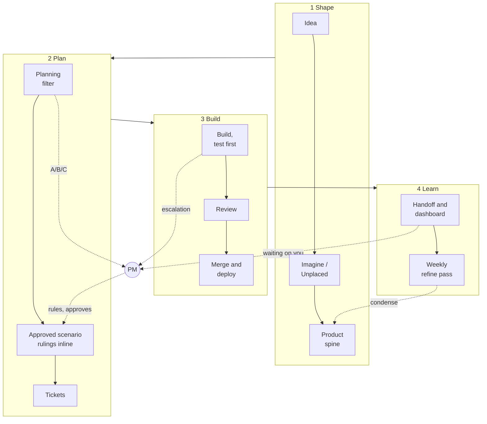

# socialus-ops

**As of 2026-10-23** · Source: the live repos, the planning dashboard, workflows and scheduled tasks read today · Generated by: `regen-readme`

**How SocialUs gets built: the method agents follow, from an idea to a shipped feature.** No product code lives here.

## How we build, step by step

**Every feature walks the same path, and the PM steps in only where judgement is needed.** Agents prove a change is correct; the PM decides whether it is right. *Why agents need it:* pass/fail criteria mean they build exactly what was approved; test-first means nothing breaks unseen.

1. **Idea**: anyone raises it. Nothing is promised yet.
2. **Imagine / Unplaced**: shapeless ideas wait in `IMAGINE`; anything else homeless waits in the junk drawer, at most 14 days.
3. **Product spine**: once an idea has a noun, a verb or a screen, it enters the product model.
4. **Planning filter**: a council of agents writes a short brief with options. **The PM approves or picks A/B/C.**
5. **Approved scenario**: the pass/fail criteria, with the PM's rulings written right inside it.
6. **Tickets**: one Issue per piece of work.
7. **Build, test first**: a check is seen failing before the code is written.
8. **Review**: a second agent reviews. Screens get a look at phone width.
9. **Merge and deploy**: green checks merge. **The code repo's main deploys to production.**
10. **Handoff and dashboard**: the dashboard rebuilds daily and on every merge; the handoff saves state for the next session. **The PM looks and ticks.**
11. **Weekly refine pass**: on Fridays the scores run, docs near their size limit are rewritten shorter, and the launch report goes out.

Details

| Step | Who | Reads → writes | The PM |
|---|---|---|---|
| 2 | any agent | → `IMAGINE.md`, `UNPLACED.md` | none |
| 3 | planning agent | → product spine (`product/`) | none |
| 4 | `plan-feature` (council) | spine, principles → feature brief | approves, or picks A/B/C |
| 5 | planning agent | brief → scenario, rulings inline | rules on new territory |
| 6 | `write-tickets` | scenario → Issues | none |
| 7 | `build-ticket` | Issue, constraints → code and tests | escalations only |
| 8 | reviewer agent, `review-pr-bundle` | the PR → review | when a review needs a call |
| 9 | code agent | → main | new copy, anything reaching production |
| 10 | Dispatch | GitHub → dashboard, handoff state | ticks the checklist |
| 11 | `tend-docs`, `score-*` (Fridays) | docs, CI → shorter docs, scores | at most 3 calls a week |

New this week in the code repo's 34 workflows: a report self-test and a main-build alarm.

## Who does what

**The PM rules; agents build and prove.** Each agent sees only the files its role needs. *Why agents need it:* a narrow view keeps them off another role's half-finished work.

Details

- **PM:** rulings, whether something is right, the look. Never reads code.
- **Planning agent (Cowork):** scenarios, principles, the product model. Never commits code.
- **Code agent:** Issues, test-first code, PRs, merge on green. Never writes scenarios or rulings.
- **Dispatch:** phone intake, the handoff, the dashboard.
- **Repos:** plan (what and why), web (the app), ops (this method), skills (32), legal (private), design (local).

## Where things live

**Each kind of thing has one home, and docs hold what is true now plus why, never history.** Git keeps the history. *Why agents need it:* one home per fact, so nothing is lost and nobody re-asks the PM.

Details

- **Principles** (the why behind the Charter): `PRINCIPLES.md`, reworded as they get clearer.
- **Rulings** (dated PM decisions): inside the scenario they govern, then its product doc once shipped.
- **Where we are and where we're going:** the dashboard.
- **The full map, for agents:** `process/WHERE-THINGS-GO.md`; who reads what: `process/PM-AND-AGENTS.md`.

## Tags

**A tag is a short label on a ruling or note so agents can't miss it.** It says who a ruling binds, whether it holds `[always]` or only `[for now]`, what it replaces, or that a question is still open. *Why agents need it:* they see which rulings bind their work and which are up for review at the next release.

Details

- **Binds:** which agents and screens a ruling applies to.
- **Replaces:** names the older ruling a new one overrides; the old one is deleted.
- **Open question:** marks an undecided point where it was raised, with its owner.
- **Guards:** links a test to the criterion it proves.

## Where we are

**The dashboard is the one place to look.** It shows the criteria met across all features, which features are red, how long the PM's look is overdue, and the open Issues in Beta (which runs to April 2027, no freeze) and After beta. *Why agents need it:* the roll-up and "lost since last look" catch a feature that quietly disappears or loses its test.

Details

- **Progress counts criteria** (built, checked, reviewed, smoked), not Issues closed.
- **Your review counts journeys:** 3-minute walk-throughs on the phone checklist (#519); one tick covers its criteria.
- **Since your last look:** 15 PRs merged, 54 criteria newly met, 18 lost, in 7 days.
- **Where we're going:** Now 20, Next 7, Considering 11, Later 62.

## Docs stay short

**Every doc has a size limit, and Friday's refine pass condenses whatever is close to it.** Human views are generated, never hand-kept. *Why agents need it:* short docs stay readable for the next agent, saving spend and stale answers.

Details

- A doc over its limit can only shrink. The junk drawer holds at most 20 items, each for at most 14 days.
- Today: 132 docs in scope, 63 undated (target under 5), 0 broken links.

## Safety

**Moderation follows the PM's rulings, and the staff safety runbook is rebuilt whenever a ruling changes** (last 2026-10-16). Apparent child abuse material is a legal duty, not a judgement call. *Why agents need it:* staff steps come from the rulings, so they can't drift.

Details

- One section per severity tier. Child abuse material is preserved, viewed only as needed, and reported to NCMEC during beta.
- The launch checklist reminds us to register with NCMEC and turn on Cloudflare scanning.

## The trial: scoring the pipeline

**A trial scores how well the pipeline itself works, so the method keeps improving.** All three scores read red today; the tuning note says most of that is the scores miscounting, not the pipeline. *Why agents need it:* a score that goes red shows where the method wastes time or money.

Details

- Built: CI health, doc drift, gaps hidden by closed Issues. Next: review coverage. Tracker #89; tuning review 2026-10-24.
- Three fixes wait on your `pm-approved` label: #133 (doc drift), #134 (gap leakage), #142 (CI health); each removes a false red.
- Real reds: tap-speed red four days running (#978); the skills repo's checks blocked by billing.

## Gaps

**The biggest gaps: no PM walk-throughs yet, the handoff hasn't saved state in 12 days, and fewer than half the criteria have a real test.** *Why agents need it:* untested criteria are where a change can break unnoticed.

Details

- PM looked: 0 of 285 criteria; 0 of 22 walk-throughs on #519 done.
- Checked: 116 of 285 criteria have a test; smoked 0.
- The handoff last saved state on 2026-10-11; only the Friday task is scheduled.
- Timed workflows all fired today. Actions still can't start in `skills` (billing).
- Not checked today: whether push notifications reach a phone.

## What the PM needs to do

**Do one 3-minute walk-through, and answer what's waiting on you.** *Why agents need it:* your ticks prove a feature works for a person; answers unblock agents.

Details

1. Walk through one journey on #519, starting with "Start something without opening a shop".
2. Answer the 12 items under "Waiting on you" on the dashboard, P1 calls first.
3. Label #133, #134 and #142 `pm-approved`, or reply on #89 with what to change.

